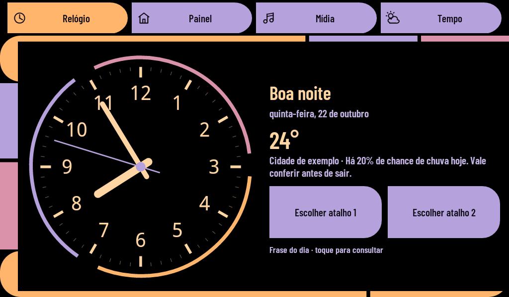
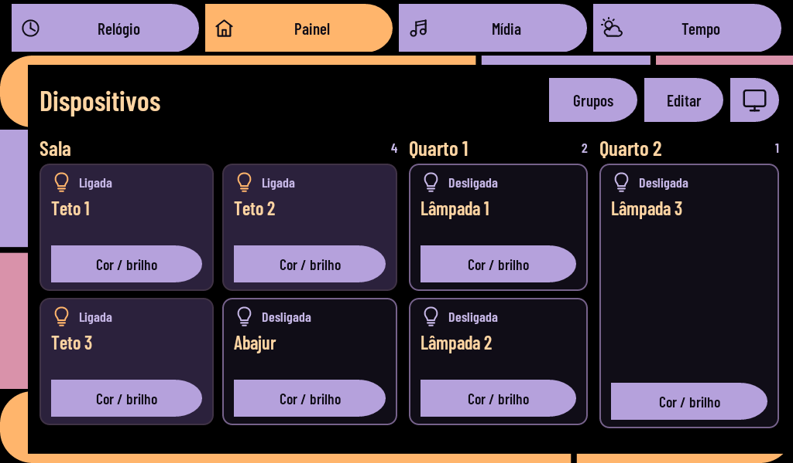

# Painel — um Galaxy Tab antigo como central de casa

Aplicativo **nativo para Android 2.2 / API 8**, feito para reaproveitar um tablet de 7 polegadas. Reúne relógio, lâmpadas Tuya Wi-Fi, Jellyfin, controle Samsung e previsão do tempo. O Home Assistant não é obrigatório.

**Versão 0.8:** tema inspirado no LCARS de *Star Trek: The Next Generation*, fonte condensada incorporada e alternativa para usar a fonte do tablet. Esta edição pública começa sem nomes pessoais nem endereços de aparelhos.




## O que funciona

| Área | Recursos |
| --- | --- |
| Relógio | Bauhaus ou quadrado, saudação por horário, nomes opcionais com troca animada, dois atalhos para lâmpadas ou grupos |
| Iluminação | Tuya local, importar um JSON único, ligar/desligar, brilho, RGB e branco quente/frio, grupos, nomes/cômodos/ordem editáveis |
| Mídia | Jellyfin direto por HTTP, Quick Connect ou senha, biblioteca em lista/grade, capa/cartaz, fila, progresso e letras disponíveis no servidor |
| Saída | Música no tablet ou sessão Jellyfin aberta na TV; vídeos na TV |
| TV Samsung | Pareamento LAN, volume, mudo, entradas, canais, navegação, transporte e tentativa de ligar por Wake-on-LAN |
| Tempo | Sete dias, ícones, chance/volume de chuva, temperatura, vento, UV e recomendações com base na previsão |
| Voz opcional | Palavra “Alexa”, português, pedidos de iluminação, TV, música e clima; reconhecimento e resposta em uma ponte Docker local |
| Aparência | Branco, Escuro, Bauhaus, Casa, Tátil e LCARS; horizontal/vertical; tecla física Menu para ajustes e Busca para mídia |

LCARS é uma interpretação gráfica original: fundo preto, curvas em L, barras segmentadas e tons pêssego/lilás, desenhados em Canvas. Não inclui imagens, logos ou sons extraídos da série. Projeto independente, sem vínculo com a franquia.

## Instalar e começar

1. Baixe o APK em **[Releases](https://github.com/cylindratis/painel-galaxy-tab/releases)** e transfira ao tablet por USB/cartão.
2. Abra o arquivo no gerenciador do Android. Atualizações exigem o mesmo pacote e assinatura; guarde a chave se compilar sua própria versão.
3. O primeiro início usa **DEMO**, com dados fictícios. Configure serviços e desligue DEMO em **Menu > Ajustes** para controlar aparelhos reais.
4. Escolha **Menu > Tema > LCARS · The Next Generation**. Em Ajustes, **Fonte do LCARS** alterna Barlow Condensed e a fonte do sistema.
5. Os nomes da saudação ficam em **Ajustes > Nomes da saudação**; vazio mostra apenas bom dia/boa tarde/boa noite. A versão pública não contém nomes da residência usada no desenvolvimento.

Relógio, dispositivos, iluminação e controle da TV procuram caber sem rolagem. Biblioteca, clima, voz e ajustes podem rolar. A opção de 60 quadros/s é uma meta de desenho, não uma alteração dos Hz físicos da tela.

## Conectar seus serviços

**Tuya:** obtenha IP reservado, ID, local key e protocolo do seu próprio dispositivo. Preencha um arquivo conforme [lampadas.example.json](examples/lampadas.example.json), copie ao tablet e use Menu > Importar lâmpadas. Os DPs do exemplo não servem para todo modelo: confirme o perfil real antes de enviar cor/brilho. Reimportar atualiza cadastros sem duplicá-los; importar consulta estados, sem acionar lâmpadas.

**Jellyfin:** informe uma URL completa em Ajustes, teste e entre por Quick Connect ou usuário/senha. Autorize o código num cliente já autenticado. Escolha Tablet ou TV no player antes de reproduzir. Música no tablet usa MP3 fornecido/transcodificado pelo servidor; vídeos são enviados a uma sessão Jellyfin controlável na TV. Letras dependem da biblioteca. [Detalhes de mídia e TV](docs/INTEGRATIONS.md).

**TV Samsung:** configure IP/MAC em Controle da TV > Conexão e autorize o Painel na tela da TV. A identificação e UPnP foram consultados numa Samsung série K5300; os comandos foram testados em simulador. Wake-on-LAN em espera e entradas diretas dependem do aparelho/firmware. Enviar uma tecla não comprova que a tela mudou.

**Voz:** precisa de um computador Linux/Docker ativo. Não é uma integração com contas Amazon. Instale a ponte conforme [docs/VOICE.md](docs/VOICE.md), configure a URL/chave no tablet e ative a escuta. O microfone é opt-in, tem indicador e desliga ao sair do Painel. Toque em **Executar frase digitada** para testar o entendimento: fora de DEMO, isso executa comandos reais.

Exemplos: “Alexa, liga as luzes da sala”, “deixa a sala azul”, “coloca a sala em 50 por cento”, “toca Artista de teste”, “toca música samba”, “aumenta o volume da TV”, “vai chover amanhã?”. Use os nomes cadastrados; pedidos ambíguos não acionam dispositivos. Artista/gênero carrega páginas completas, com limite explícito de 10 mil músicas para este aparelho.

## Como foi construído

- **Java 6 + framework API 8**, sem Gradle, WebView, AndroidX ou renderização remota. O APK é pequeno e a interface é desenhada pelo Android original.
- **Canvas e Drawables** para relógio, ícones, seletores RGB/temperatura e LCARS. Elementos estáticos do relógio ficam em cache; não há efeitos decorativos pesados.
- **Protocolo Tuya LAN** com mapeamento editável de DPs. O grupo confirma cada dispositivo; não apresenta envio como sucesso confirmado.
- **HTTP Jellyfin** com cabeçalho MediaBrowser atual, Quick Connect e fila mantida pelo app. Uma sessão remota que aceita só uma faixa recebe a seguinte após informar o fim da anterior.
- **MediaPlayer** para áudio, incluindo resposta falada a partir de arquivo privado aberto por descritor — importante no Froyo.
- **Samsung LAN** com WebSocket mascarado, autorização/token, UPnP para áudio e pacote Wake-on-LAN.
- **Ponte de voz** com openWakeWord, faster-whisper small CPU/int8 e eSpeak NG. Áudio de microfone fica em memória durante o processamento; não se mantém arquivo de gravações.
- **Design iterativo com Impeccable e Taste**: tema adaptado às restrições de toque, contraste e espaço de um tablet antigo; capturas e testes em Views reais do Android, não apenas mockups web.

Leia a [arquitetura](docs/ARCHITECTURE.md), as [instruções de compilação](docs/BUILD.md), a [validação e limites](docs/TESTING.md) e a [preparação desta versão pública](docs/PRIVACY.md).

## Compilar

Precisa de **Java 8** com `keytool` e **Python 3**. No Linux, também são necessárias as bibliotecas do sistema usadas pelas ferramentas Android antigas.

```sh
python android/build.py --java /caminho/para/java --output dist/Painel.apk
```

O script baixa o SDK API 8, ferramentas de build e ECJ de Google/Maven, compila Java 6, gera DEX, alinha e assina v1. A chave de desenvolvimento é criada em `android/build/signing/`, ignorada pelo Git. Para releases, use sua chave externa e `PAINEL_KS_PASS`; a chave das releases deste repositório não é publicada. [Guia de build](docs/BUILD.md).

## Privacidade da publicação

Este repositório foi criado do zero a partir de uma lista explícita de fontes permitidas. **Não contém histórico do projeto privado**, configurações da residência, chaves de assinatura, senhas, tokens, MACs ou IPs reais. Exemplos usam endereços de documentação `192.0.2.x`; loopback, broadcast e `10.0.2.2` de emulador são parâmetros técnicos, não endereços da residência. Capturas usam DEMO e saudação sem nomes.

Android 2.2 não oferece a compatibilidade TLS de um sistema atual. Use o app e as pontes na sua rede de confiança. Não é necessário expor portas do roteador para a internet, e o app não ignora validação de certificados.

## Créditos

- Inspiração LCARS: trabalho de Michael Okuda e equipe em *The Next Generation*. Referência: [Art Directors Guild](https://assets.adg.org/media/submissions/2023-09-30_21-38-05/ADG_PICARD.pdf).
- Barlow Condensed: The Barlow Project Authors; [Google Fonts](https://github.com/google/fonts/tree/main/ofl/barlowcondensed), licença [SIL OFL 1.1 incluída](android/assets/fonts/OFL.txt).
- [Jellyfin](https://github.com/jellyfin/jellyfin), [TinyTuya](https://github.com/jasonacox/tinytuya), [Samsung TV WS API](https://github.com/xchwarze/samsung-tv-ws-api), [openWakeWord](https://github.com/dscripka/openWakeWord), [faster-whisper](https://github.com/SYSTRAN/faster-whisper), [eSpeak NG](https://github.com/espeak-ng/espeak-ng), [Open-Meteo](https://open-meteo.com/).

As dependências, fonte e modelos conservam suas próprias licenças. Os modelos são baixados pela ponte, não incluídos no APK.
